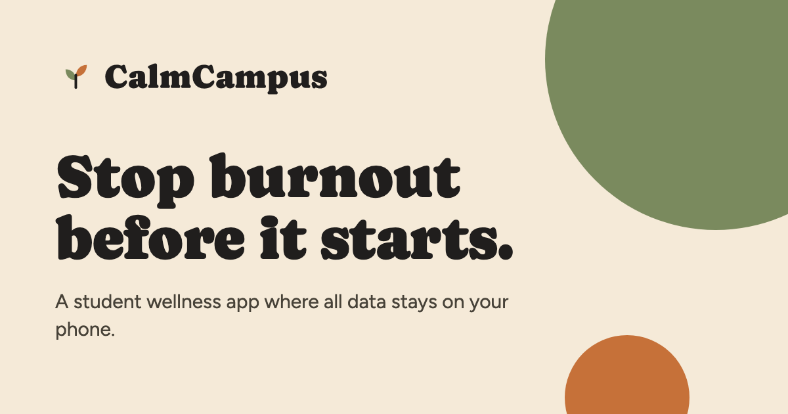

# CalmWeb

[](https://github.com/lumenworksco/_CalmWeb/actions/workflows/ci.yml)
[](LICENSE)


**The web side of [CalmCampus](https://github.com/lumenworksco/CalmCampus)**, a privacy-first wellness companion for university students: the pitch site, the impact report and the evidence dossier behind their claims. Live at [**cc.braunf.com**](https://cc.braunf.com/).

<p align="center">
  
</p>

## What's here

| Path | What it is |
|---|---|
| [`docs/`](docs/) | The site. Plain HTML/CSS/JS, no build step: `index.html` (pitch), `report.html` (impact report), `CalmCampus-One-Pager.pdf`, shared `tokens.css`, and the public form pages (`f/`, `forms/`) |
| [`admin/`](admin/) | The private forms admin: builder, settings, sharing, results. Served from its own origin |
| [`worker/`](worker/) | Cloudflare Worker that receives form submissions, so respondents never talk to the database directly |
| [`supabase/`](supabase/) | Database schema, row-level security and its tests |
| [`tests/`](tests/), [`scripts/`](scripts/) | Unit tests, the dev server and the site checks |
| [`research/`](research/) | Evidence dossier (PDF), source index (`index.csv`, one row per cited paper), notes and research log |

The iOS app, the on-device model and the design mockups live in the [CalmCampus](https://github.com/lumenworksco/CalmCampus) repo.

## Forms

CalmWeb includes a custom form platform (builder, public forms, results) in the CalmCampus design system, with an anonymous mode that the system enforces rather than just promises. The first form on it is an anonymous demand case study. Architecture, privacy model, data model and go-live steps are in **[FORMS.md](FORMS.md)**.

## Run it locally

The site alone needs nothing installed:

```bash
python3 -m http.server 3400 --directory docs
```

To run the site **and** the forms platform (public forms, admin at `/admin/`, the real Worker code and an in-memory stand-in for Supabase, no accounts and no Docker; needs Node 20+):

```bash
node scripts/dev-server.mjs      # http://localhost:3400 , admin sign-in: any email and password
node scripts/seed-dev.mjs        # publishes the four templates, e.g. /f/case-study
```

`research/papers/` (the downloaded PDFs) is gitignored. Run `research/download_papers.sh` to fetch it again.

## Deployment

GitHub Pages serves `main` from `/docs`, with the domain set in [`docs/CNAME`](docs/CNAME). Pushing to `main` publishes the site and the public form pages.

The forms platform also needs a Supabase project, the Worker and the admin host. Those are set up once by hand (accounts, secrets and DNS), see [Going live in FORMS.md](FORMS.md#going-live). The environment variables are:

| Where | Name | What |
|---|---|---|
| Worker secret | `SUPABASE_URL` | Supabase project URL |
| Worker secret | `SUPABASE_SERVICE_KEY` | Supabase service key. Never commit it |
| Worker secret | `CHALLENGE_SECRET` | Long random string that signs the spam-check challenges |
| Worker, local only | `ORIGIN` | In `worker/.dev.vars` (gitignored), to proxy the site while developing the Worker alone |
| `admin/config.js` | project URL, anon key | Public by design; row-level security protects the data |

## Checks

CI runs three jobs: the site check (every local link resolves, and no page, stylesheet or script loads anything from another host), the unit tests, and the database tests on a real PostgreSQL. Run the same before you push:

```bash
python3 scripts/check-site.py
node --test tests/*.test.mjs
bash supabase/tests/run.sh      # needs PostgreSQL 14+ binaries (initdb, pg_ctl, psql)
```

## Principles

- **Every claim has a source.** Numbers on the site trace to a row in `research/index.csv`.
- **Wellness wording, not medical claims.** The product "supports", it does not "detect burnout".
- **No trackers.** No analytics, third-party scripts, fonts or embeds, matching the app's on-device promise. Where a form stores data on a server, it says so.
- **Anonymous means anonymous.** Anonymous forms store no IP, device details or fine-grained timestamp, and nothing links an answer to a person, even for the admin. The database tests assert it.

## Contributing

Corrections to a claim or source are especially welcome, see [CONTRIBUTING.md](CONTRIBUTING.md) and the [Code of Conduct](CODE_OF_CONDUCT.md). To report a security problem, see [SECURITY.md](SECURITY.md).

## Team

- **Florian Braun**: Engineering Technology, UCLL
- **Helene David**: Economics and Business, UCLL

## License

[MIT](LICENSE). The CalmCampus name and logo are not covered by the license.
